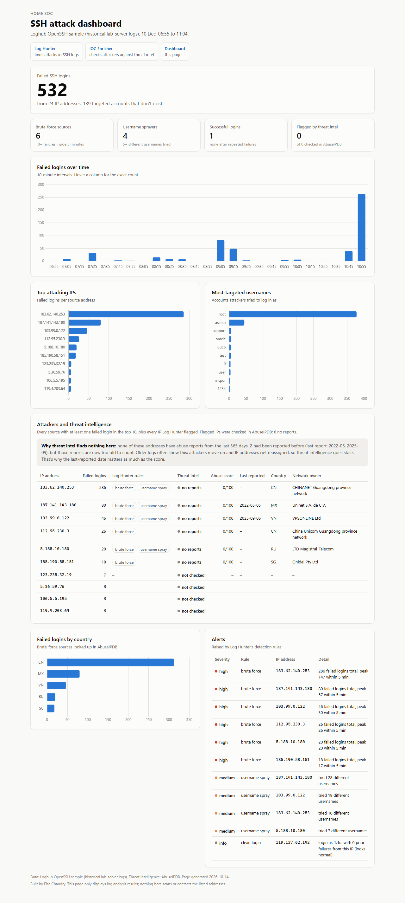

# Home SOC Dashboard

**Live demo: https://ezashi9.github.io/home-soc-dashboard/**

A web dashboard that shows SSH attacks found by [Log Hunter](https://github.com/Ezashi9/log-hunter), combined with threat intelligence from [IOC Enricher](https://github.com/Ezashi9/ioc-enricher). It's the third part of **Home SOC**, a small security operations centre I'm building piece by piece.

```
SSH server logs --> Log Hunter --> alerts.json --> IOC Enricher --> enriched.json
                                       \                               /
                                        `--> build.py --> dashboard <-'
```



## What it shows

- **Headline:** 532 failed SSH logins from 24 IP addresses; 139 of them targeted accounts that don't exist.
- **Failed logins over time:** the biggest burst was over 250 attempts in one 10-minute window.
- **Top attacking IPs** and **most-targeted usernames:** `root` was tried 378 times.
- **Attackers and threat intelligence:** each attacker with the Log Hunter rules it triggered and its AbuseIPDB verdict, score, last-reported date, country and network owner.
- **Failed logins by country** and the full **alerts** list.

Every number is in a table as well as a chart, so nothing is only visible on hover. The page works in light and dark mode and on a phone.

The sample data is the [Loghub OpenSSH dataset](https://github.com/logpai/loghub/tree/master/OpenSSH) (historical lab-server logs). Those attackers come back with no recent abuse reports, and the dashboard explains why: threat intelligence goes stale. See the IOC Enricher README for a run on live attackers, where 9 of 10 were flagged malicious.

## Security: the dashboard is built to resist its own data

Usernames in SSH logs are typed by attackers. An attacker can try to log in as ``, and a dashboard that puts that on a web page carelessly will run the attacker's code in the browser of whoever views it. This is called **log injection leading to cross-site scripting (XSS)**. Security dashboards are a real target for it, because the people viewing them often have privileged access.

Defences, from the data file to the browser:

| Layer | Defence |
|---|---|
| Data file (`build.py`) | Every `<`, `>` and `&` is written as `<`, `>`, `&`. No value can close a script tag or form HTML, even if the data is later inlined into a page. |
| Page script (`app.js`) | Data is only ever inserted with `textContent`, which treats it as plain text. There is no `innerHTML`, `document.write` or `eval`. |
| Browser policy (`index.html`) | A strict Content Security Policy: `default-src 'none'; script-src 'self'`. Inline scripts and scripts from other sites are blocked, so even if injection got through, the injected code couldn't run. |
| Dependencies | Chart.js is stored in the repo (`docs/vendor/`) rather than loaded from a CDN, so the page doesn't trust any third-party server. |

**Tested two ways.** The unit tests check all three layers. I also built the page with a malicious username (``) and a script-tag break-out in an alert, loaded it in headless Chrome, and confirmed both showed as plain text: no element was injected and no code ran.

## Usage

Requires Python 3.10+. Nothing to install.

```bash
# rebuild docs/data.js from the sample data
python build.py

# or from your own Log Hunter + IOC Enricher output
python build.py --alerts ../log-hunter/reports/alerts.json --enriched ../ioc-enricher/reports/enriched.json --dataset "My server, October"

# view it locally
cd docs && python -m http.server 8000      # then open http://localhost:8000
```

Run the tests:

```bash
python -m unittest discover -s tests -t .
```

## Project layout

```
build.py                 joins Log Hunter + IOC Enricher output into docs/data.js
docs/                    the website (served by GitHub Pages)
  index.html             page structure + Content Security Policy
  app.js                 renders tiles, tables and charts (textContent only)
  style.css              light/dark themes
  data.js                generated data
  vendor/                Chart.js 4.5.1 (MIT licence)
sample-data/             the Log Hunter and IOC Enricher output used for the demo
tests/                   unit and security tests
screenshots/
```

## Design notes

- **Static site, no server.** The page is plain files, so it's free to host, fast, and has no backend to attack.
- **One headline number.** 532 failed logins leads; everything else supports it.
- **Single-colour charts with no legends.** Each chart shows one thing, so the title says what it is. The blue was checked for contrast against both the light and dark backgrounds.
- **Status is never colour alone.** Every severity and verdict has a text label beside its coloured dot.

## Next step in Home SOC

**Honeypot:** a decoy SSH server on a throwaway cloud VM. The pipeline would then show attacks happening now, with fresh threat intelligence, instead of a historical dataset.

## Credits

- Logs: Loghub (Zhu et al., *Loghub: A Large Collection of System Log Datasets for AI-driven Log Analytics*, IEEE ISSRE 2023)
- Threat intelligence: [AbuseIPDB](https://www.abuseipdb.com)
- Charts: [Chart.js](https://www.chartjs.org) (MIT licence)
